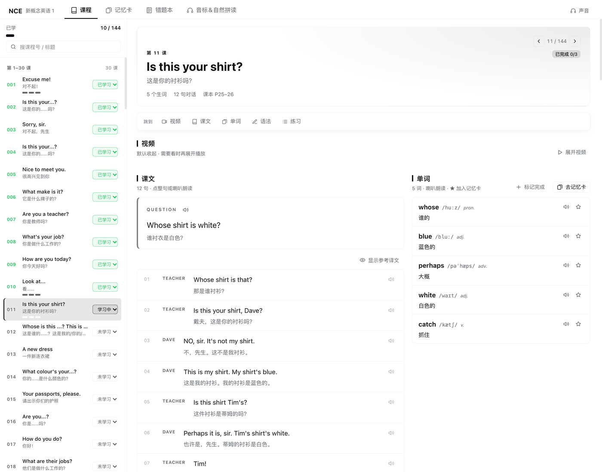
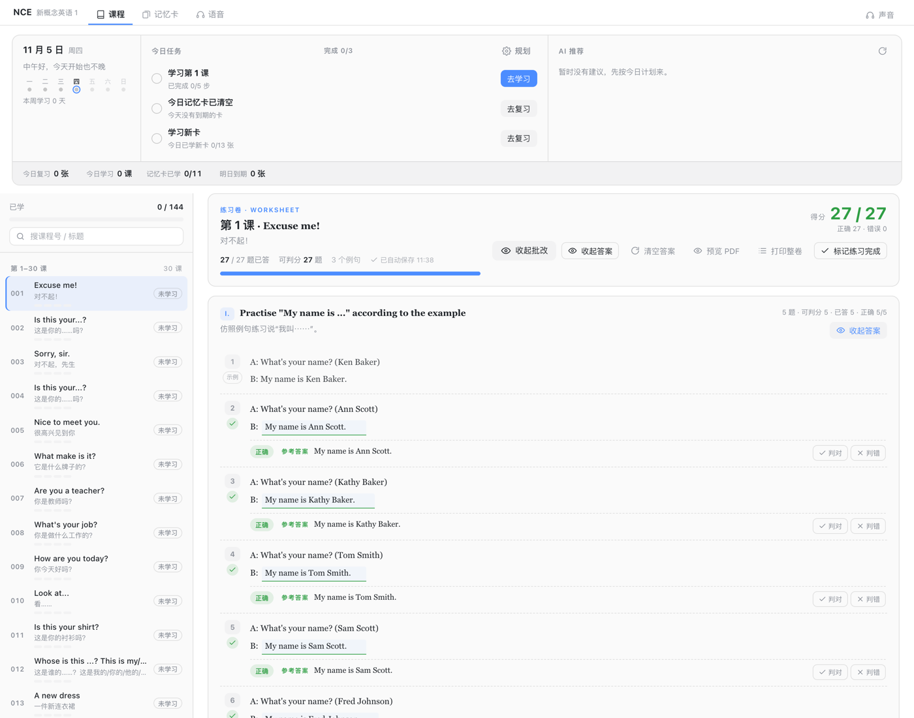
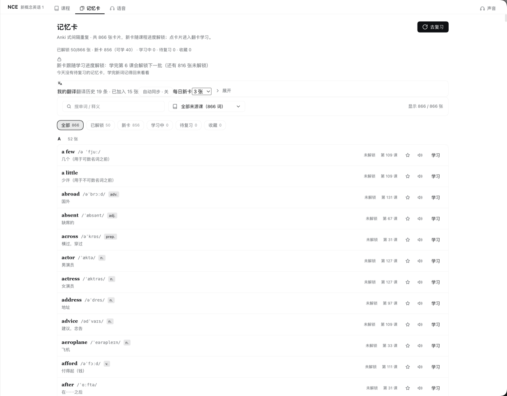
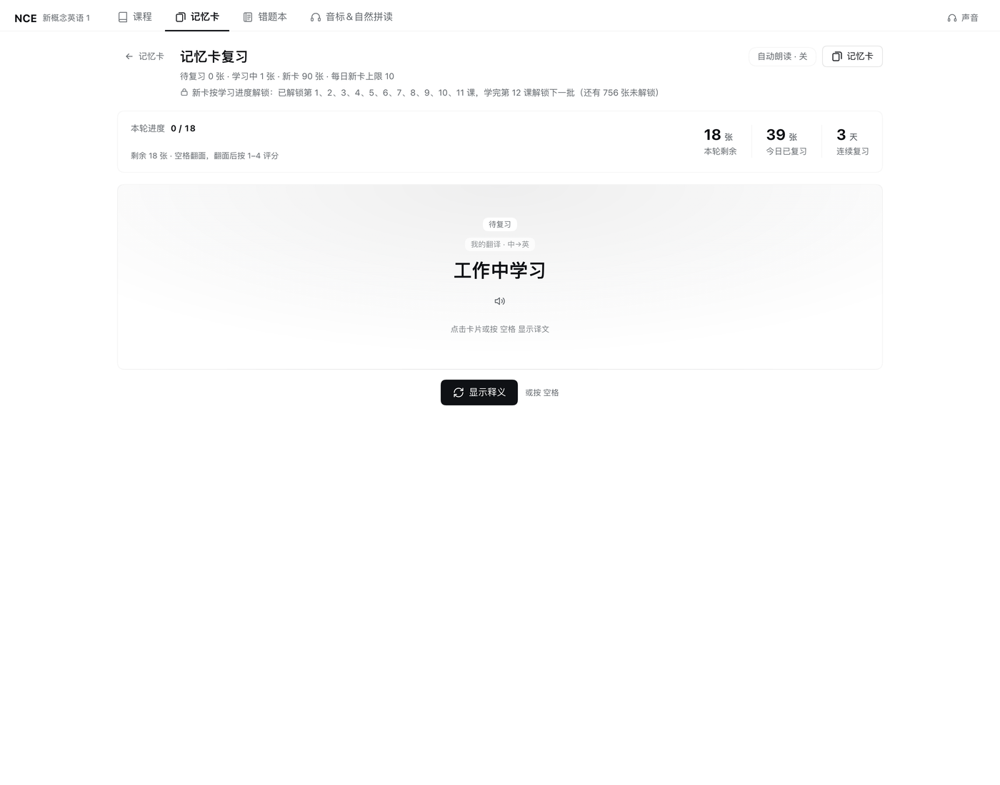
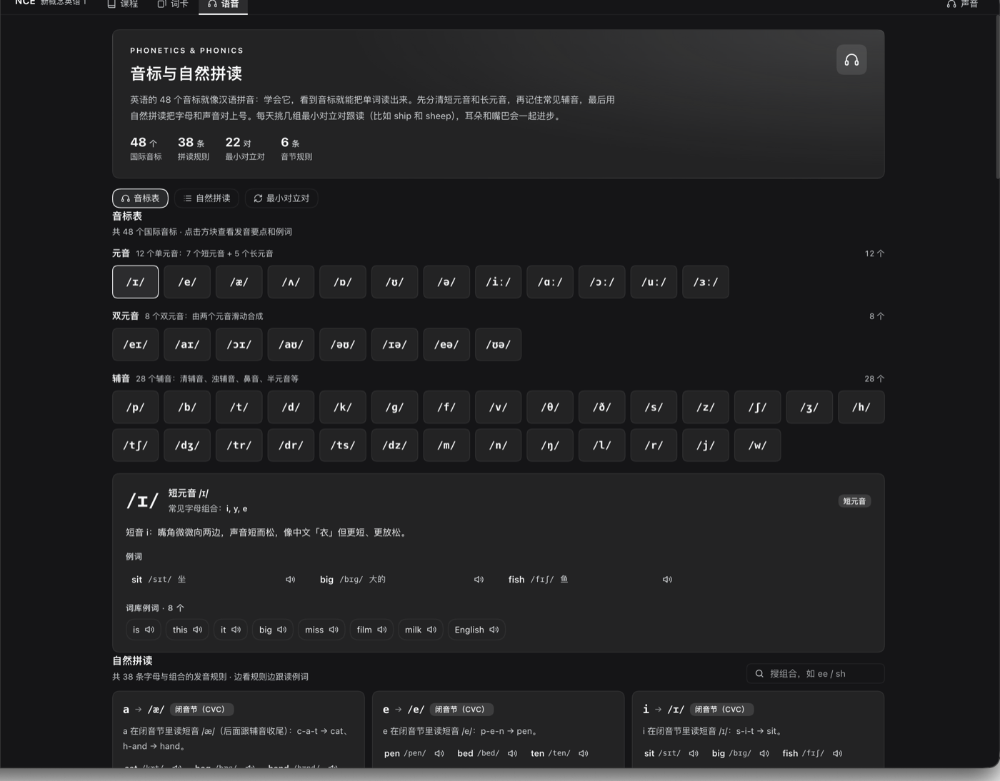
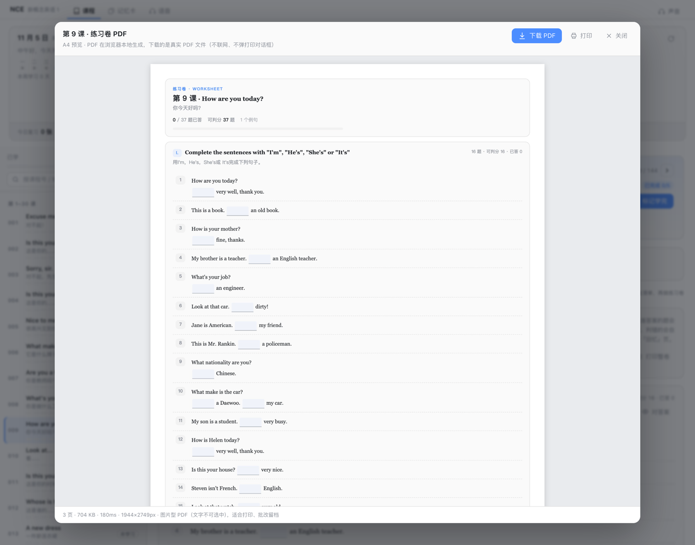

# dsh-nce

English · [简体中文](README.zh.md)


> A New Concept English Book 1 study panel that lives in the DeepSeek Harness
> sidebar: 144 lessons on one scrollable page, Anki-style SRS flashcards, a mistake
> notebook, an IPA / phonics reference, and fillable exercise papers graded by your
> own model. The host half serves `/dsh-nce/api`; the browser half renders the panel.



## Quick start

```bash
dsh plugin --profile <profile> add dsh-nce
```

Restart `dsh web` (or the desktop app) — the 144-lesson dataset arrives with the
optional `dsh-nce-data` package, so the panel is populated on first open. No
textbook files to supply, no build step.

## Features

### Course browser

- Split view: a persistent 144-lesson list on the left and the selected lesson on the
  right, with a progress line (`已学 x / 144`), search, four lesson groups, a status
  dropdown (not started / learning / done) and current-lesson highlight. Three step
  dots per lesson (words / grammar / exercise) show where you stopped; the panel opens
  on your last lesson or the next unfinished one and collapses to one column when narrow.

### One-page lesson

- Header (prev / next, number, English + Chinese title, counts, textbook pages, status)
  plus a sticky anchor bar that smooth-scrolls to `Video / Text / Words / Grammar /
  Practice`. **Video** is collapsed by default; expanding loads an embedded Bilibili
  player mapped to the right part, and a custom Bilibili / YouTube URL can be saved per
  lesson with the built-in one restorable at any time.
- **Text + words** — two columns: question, dialogue lines (click a line or the speaker
  to read it aloud) and collapsible reference translation on the left; a vocabulary
  table with IPA, part of speech, meaning, read-aloud, and star-to-flashcards on the
  right. Stacks automatically on narrow containers.
- **Grammar** — textbook notes plus classroom-notes blocks; **Practice** — a per-lesson
  homework checklist, a classroom recall card, and the fillable worksheet. The three
  study steps are toggled from the status dropdown (choosing "done" checks all three)
  or each section's "mark complete" switch.

### Fillable exercise papers

- Rendered from the textbook layout: blanks become inline inputs, matching questions
  become real Column A / B tables graded from the answer key, tabular questions become
  tables, word boxes become bordered cards, and printed worked examples stay static.
  `Enter` / `Shift+Enter` move between blanks; drafts autosave to `localStorage` per
  lesson and survive lesson switches and a DSH restart.
- **One-click grading = AI teacher grades the whole paper.** Every answered question is
  sent to the profile's default model with the answer-key reference; the reply is
  per-question `correct / close / wrong` plus a comment and reference answer, the score
  is AI-correct / total, and every verdict can be overridden by hand. Without a default
  model (or on failure) it degrades to deterministic system grading with a header note.
- **Local PDF** — "Preview PDF" shows the real A4 pages and "Download PDF" generates an
  image-based PDF entirely in the browser (no network, no server, no print dialog).

### Mistake notebook

- Questions graded **wrong** or **close** are collected automatically and fixed ones
  drop out; grouped by lesson with your answer, reference answer, AI comment, verdict,
  and timestamp, filtered by all / wrong / close. Locally saved graded papers are
  scanned once so earlier mistakes are backfilled.
- **AI explanation** per question explains the correct answer, the mistake (word order /
  tense / agreement…) and a memory hint, cached on the question.

### Flashcards and spaced repetition

- Cards come from the de-duplicated 866-word word bank; search and filter by lesson.
  `Space` flips, `1`–`4` grade — Anki-aligned **Again (1 min) / Hard (10 min) / Good
  (tomorrow) / Easy (4 days)** — with new / learning / due counters and daily limit.
- **New cards follow the course**: only words from started lessons enter the queue
  (default 10/day); due cards are never locked, so reviews always come first. Sentence
  cards are imported automatically from the translation plugin's history
  (`~/.dsh/dsh-translate/history.json`, default 3/day).
- Page, selected lesson, scroll position, and expanded video are remembered per view.

### IPA, phonics and read-aloud

- 48 IPA symbols (12 monophthongs / 8 diphthongs / 28 consonants) with pronunciation
  tips, common letter combinations, and clickable example words; 38 phonics rules,
  22 minimal pairs, and syllable / stress rules.
- Read-aloud reuses the translation plugin's speech pipeline when installed (Microsoft
  Edge neural voices, no API key, shared cache), then macOS `say`, then browser speech;
  the voice menu sets voice, speed, auto-read, and preview.

## Install

### From npm (recommended)

```bash
dsh plugin --profile <profile> add dsh-nce
```

The lesson dataset is pulled in automatically as the optional `dsh-nce-data` package.

### From GitHub

```bash
dsh plugin --profile <profile> add github:ChenYichener/dsh-nce
```

### From a local clone

```bash
git clone https://github.com/ChenYichener/dsh-nce.git
dsh plugin --profile <profile> add /path/to/dsh-nce
```

### DSH desktop app

Open the Plugins page, choose "install from local directory", and pick the repo folder.

Restart `dsh web` (or the desktop app) after installing so the host half is loaded;
after that, client-only changes need a page refresh, while host-half or dataset changes
need a DSH restart because both are cached in the host process.

### Requirements

| Requirement | Notes |
| --- | --- |
| DeepSeek Harness | Plugin manifest (`dsh.bundle` patch + `dsh.client`); developed and tested with DSH 0.2.2-rc.1 and its `dsh web` / desktop web surface |
| Node.js | ≥ 20 on the machine running DSH; the host uses `node:sqlite` and falls back to JSON when unavailable |
| macOS (optional) | `/usr/bin/say` is the offline read-aloud fallback; other platforms use browser speech |
| [dsh-translate](https://github.com/ChenYichener/dsh-translate) (optional) | Adds the Edge neural voices and imports translation history as sentence cards |
| Dataset | Installed automatically as the optional `dsh-nce-data` package |

### Where the dataset lives

The lesson data ships as a separate package, `dsh-nce-data`, so the plugin code stays
free of textbook content. Resolution order:

1. `DSH_NCE_DATA_DIR` if set
2. `data/` next to the plugin (local builds)
3. the `dsh-nce-data` package

If none is present the panel still mounts and shows a Retry button instead of failing
hard. To use your own dataset, point `DSH_NCE_DATA_DIR` at a directory holding
`index.json` that follows [docs/DATA-CONTRACT.md](docs/DATA-CONTRACT.md), and build one
from material you own:

```bash
NCE_CONTENT_DIR=/path/to/nce-content npm run build:data
npm run build:phonetics   # IPA / phonics reference; needs no textbook data
```

See [docs/DATA-QUALITY.md](docs/DATA-QUALITY.md) for how the dataset is extracted and
verified. The dataset is provided for personal study; if you are a rights holder and
want it removed, open an issue and the `dsh-nce-data` package will be unpublished —
the plugin itself is code-only and keeps working with your own dataset.

## Usage

Open **NCE** in the DSH sidebar. Four destinations: `课程` (Course) / `记忆卡`
(Flashcards) / `错题本` (Mistakes) / `音标&自然拼读` (IPA & phonics), plus a `声音`
(Voice) menu in the top right.

| Action | How |
| --- | --- |
| Open a lesson | Pick it in the left list; the right pane switches instantly |
| Follow the lesson | Sticky anchor bar jumps between video / text / words / grammar / practice |
| Expand the video | Click the video section header or the "Video" anchor (collapsed by default) |
| Read aloud / change voice | Click a dialogue line or press `Enter` / `Space`; voice and speed live in the voice menu |
| Mark progress | Lesson status in the list, or a section's "mark complete" switch |
| Flashcards / paper | `Space` flips a card and `1`–`4` grade it; `Enter` / `Shift+Enter` move through paper blanks |

## Screenshots

| Course list + one-page lesson | Fillable paper with grading | Flashcards |
| --- | --- | --- |
|  |  |  |

| SRS review (four grades) | IPA & phonics | Local A4 PDF preview |
| --- | --- | --- |
|  |  |  |

## How it works

- **Host half.** `cordis.patch.yml` inserts one plugin row; `index.js` is a thin
  composition root that wires `src/host/` (clean architecture: `domain` rules →
  `application` use cases with injected ports → `infrastructure` SQLite/JSON/data/
  speech/LLM adapters → `http` transport) and mounts `POST /dsh-nce/api/<op>` on the
  host web server.
- **Browser half.** `client.js` is generated from `src/client/NN-*.js` fragments by
  `scripts/build-client.mjs`; fragments are concatenated in ascending two-digit layer
  order and may only reference earlier layers. React and the host theme come from the
  DSH module table.
- **API and storage.** JSON in / JSON out (`{ ok: true, ... }` or `{ ok: false, error }`)
  behind a loopback `Host` fence. Lesson status, SRS cards, streak, and saved video URLs
  live in SQLite (`node:sqlite`, WAL) with a JSON fallback; paper drafts, homework,
  mistakes, and UI preferences live in browser `localStorage`. AI grading uses the
  profile's default model through the host LLM gateway; no API key is stored.

Deeper contracts: [PLUGIN-ARCH](docs/PLUGIN-ARCH.md) ·
[API-CONTRACT](docs/API-CONTRACT.md) · [PERSISTENCE](docs/PERSISTENCE.md) ·
[LEARNING-FLOW](docs/LEARNING-FLOW.md) · [EXERCISE-PAPER](docs/EXERCISE-PAPER.md) ·
[DATA-CONTRACT](docs/DATA-CONTRACT.md) · [DATA-QUALITY](docs/DATA-QUALITY.md).

## Data & privacy

| What | Where |
| --- | --- |
| Learning progress (status, SRS, streak, video URLs) | `~/.dsh/dsh-nce/nce.sqlite` (+ `-wal` / `-shm`), legacy `~/.dsh/dsh-nce/progress.json` |
| Paper drafts / homework ticks / mistakes / UI state | `localStorage` → `dsh-nce/paper/v1/lesson-<n>`, `dsh-nce/homework/v1/lesson-<n>`, `dsh-nce/mistakes/v1`, `dsh-nce/nav\|scroll\|ui\|prefs/v1/*` |
| Read-aloud cache / translation history (read-only) | `~/.dsh/dsh-translate/tts-cache/` (or `~/.dsh/dsh-nce/tts-cache/`), `~/.dsh/dsh-translate/history.json` |
| Course content | Read-only; resolved from `DSH_NCE_DATA_DIR`, a local `data/`, or the `dsh-nce-data` package |

Nothing is uploaded by default: progress, drafts, and the mistake notebook stay on the
local machine. Data leaves it only for features that need the network — the Bilibili
video embed, Microsoft Edge voices, and AI grading (sent to the model configured in
your DSH profile). The plugin repository ships no personal data; the lesson dataset
lives in the separate `dsh-nce-data` package.

## Configuration

There is no config file: daily new-card limits, the translation-card limit, voice,
speed, and auto-read live in the panel UI and are stored in `localStorage`; host routes,
state directory, and body limits are fixed in `src/host/config.js`. `NCE_CONTENT_DIR` is
a build-time variable for `npm run build:data` only — the running plugin never reads it.

## Development

```bash
npm run build              # regenerate client.js from src/client fragments
npm run build:check        # fail if client.js is stale (writes nothing)
npm run check:architecture # layering / fragment order / dead code / doc paths guard
npm test                   # full suite, rebuilds client.js first
```

| Command | What it covers |
| --- | --- |
| `npm run test:data` | data hygiene, IPA validity, OCR-junk guards |
| `npm run test:paper`, `test:paper-ui` | exercise-paper parser/grading engine against the real 144-lesson data, plus paper UI states |
| `npm run test:ai-grade`, `test:explain` | AI-grading / explanation input sanitising, prompts, model-output parsing |
| `npm run test:host-domain`, `test:lesson-page` | SRS, progress and unlock rules, one-page lesson layout |
| `npm run test:mistakes`, `npm run smoke:api` | mistake notebook store/page; every `/dsh-nce/api` op with an isolated `HOME` |

`npm test` runs all of the above (12 steps) and boots the host API against a temporary
`HOME`, so your real learning data is never touched. Build the dataset first
(`npm run build:data`) — data-dependent steps fail without it, which is expected for a
fresh clone.

## Project layout

```text
dsh-nce/
├── index.js                 # host composition root; mounts /dsh-nce/api
├── src/host/                # domain / application / infrastructure / http layers
├── client.js                # browser bundle (generated by scripts/build-client.mjs — do not edit)
├── src/client/              # layered fragments, concatenated in NN order
│   └── generated/           # generated fragments (Bilibili part map)
├── scripts/                 # data/client builds, architecture guard, data checks, tests
├── locale/{en,zh}.json      # plugin manager title and description
├── docs/                    # architecture, API, data, persistence and paper contracts
└── data/                    # local dataset build output — gitignored, never published
```

## FAQ / Troubleshooting

| Symptom | Fix |
| --- | --- |
| Course list shows a load error | Install the `dsh-nce-data` package (or set `DSH_NCE_DATA_DIR`) and restart DSH |
| Code changes do nothing | Host half (`index.js`, `src/host/`) is cached — restart `dsh web`; client changes need `npm run build` + page refresh |
| No sound | Check the voice menu; non-macOS needs browser speech, and online Edge voices need the translation plugin plus network |
| AI grading says unavailable | The profile has no default model (or the call failed); the paper falls back to system grading and verdicts can be overridden manually |
| Video area is blank | The embed needs network access to Bilibili; save a custom URL if the built-in one is unavailable |
| Where is my progress / how do I reset it? | `~/.dsh/dsh-nce/nce.sqlite`; backup and reset commands are in [PERSISTENCE](docs/PERSISTENCE.md) |

## Compatibility

- macOS, Windows, and Linux for the panel itself (a browser surface inside DSH); the
  `say` read-aloud fallback is macOS-only, other platforms fall back to browser speech.
- Built against the DSH plugin manifest used by `dsh 0.2.x`; a change to that manifest
  or to the client module table could require a plugin update. The textbook dataset is
  platform-independent and resolved at runtime from the three locations listed above.

## Related DSH plugins

| Plugin | What it does |
| --- | --- |
| [dsh-book](https://github.com/ChenYichener/dsh-book) | Markdown draft library + AI copywriting workspace for Xiaohongshu / WeChat / generic posts |
| [dsh-notify](https://github.com/ChenYichener/dsh-notify) | Native desktop notification when a session finishes while DSH is in the background |
| [dsh-pomodoro](https://github.com/ChenYichener/dsh-pomodoro) | Distraction-free Pomodoro timer in the sidebar |
| [dsh-translate](https://github.com/ChenYichener/dsh-translate) | Chinese/English translation workbench with an always-on AI tutor and neural read-aloud |
| [dsh-nce](https://github.com/ChenYichener/dsh-nce) | New Concept English Book 1 study panel (lessons, SRS flashcards, mistake notebook) |

## License

[MIT](LICENSE) © 2026 chenyichen. The plugin code is MIT-licensed and does **not**
include any textbook content: the lesson dataset is compiled locally from material the
user owns. New Concept English and the related books, exercises, and audio are the
property of their respective authors and publishers; the embedded video player streams
third-party videos from Bilibili. Use the plugin only with content you are entitled to
use.
