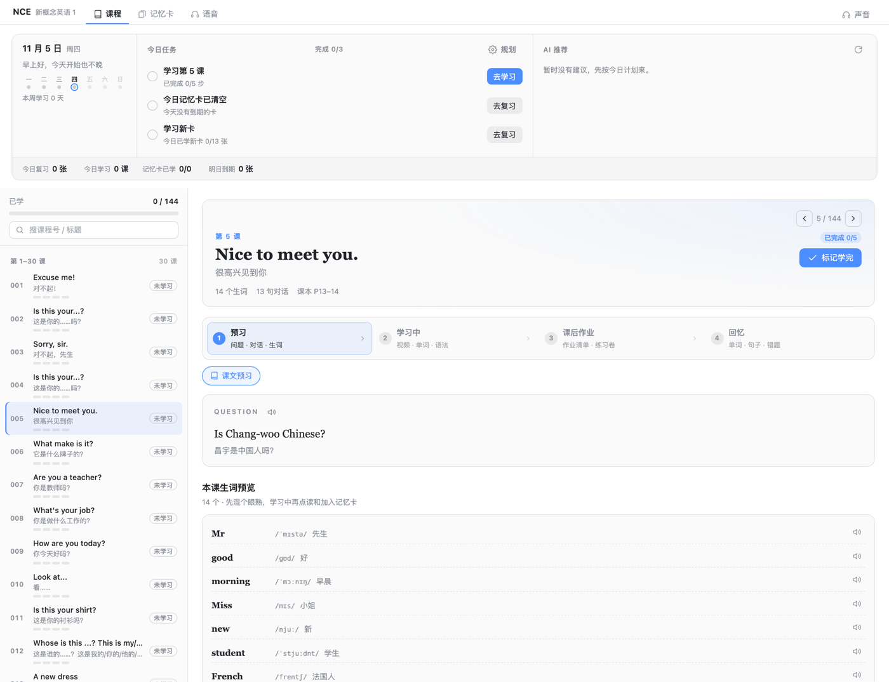
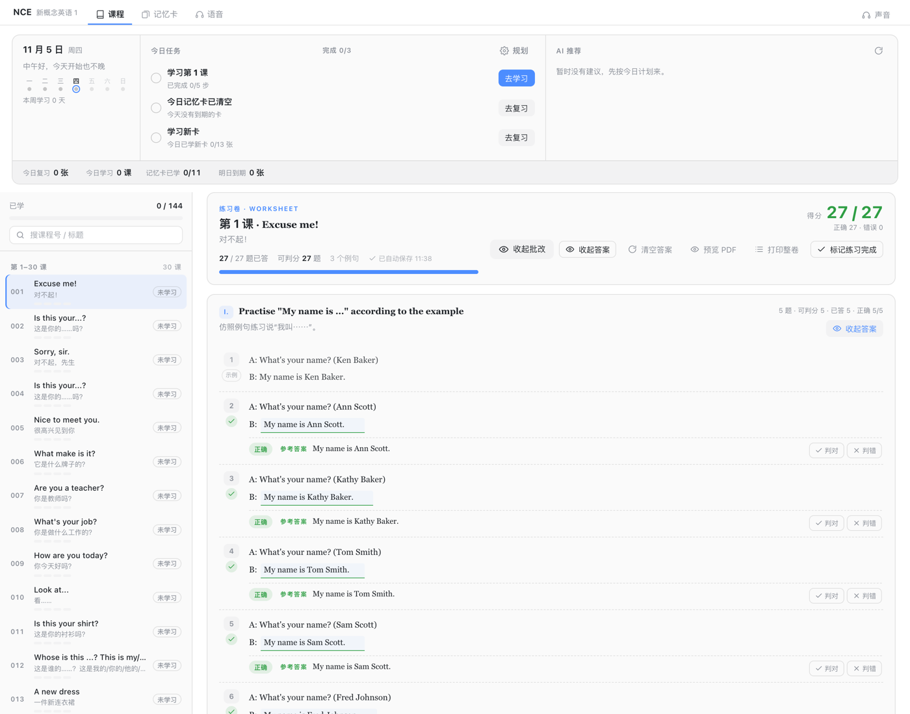
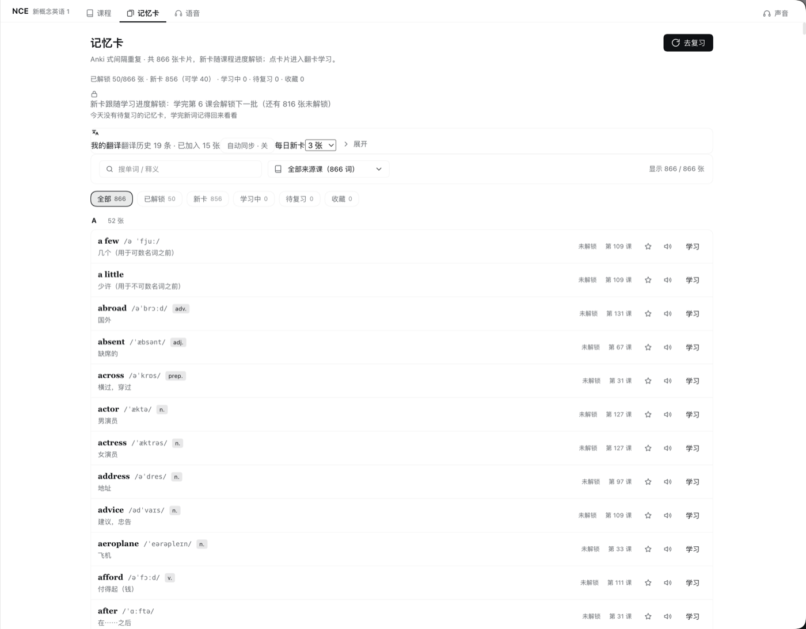
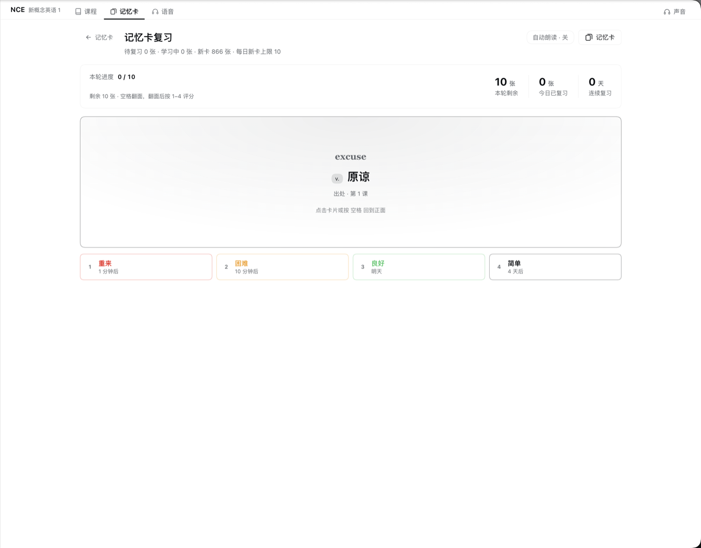
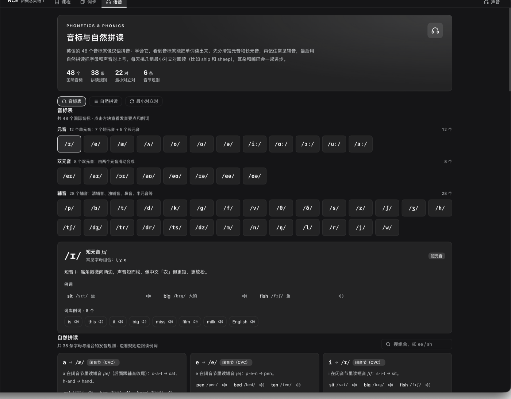
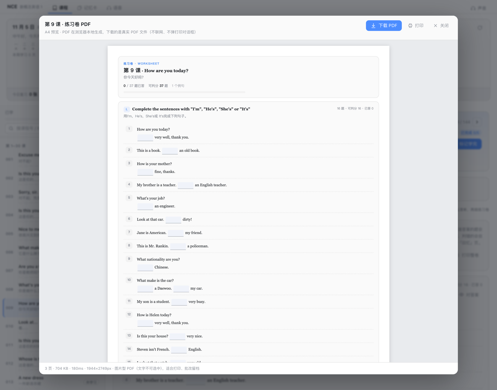

# dsh-nce

[English](README.md) · 简体中文


> 在 DeepSeek Harness 侧边栏里学《新概念英语》第一册：144 课单页式学习（视频 / 课文+单词 /
> 语法 / 可填写练习卷）、Anki 式 SRS 记忆卡、错题本、音标与自然拼读；练习卷由当前
> profile 的默认模型整卷批改。Host 半挂 `/dsh-nce/api`，浏览器半渲染面板，不用另开服务或登录。



> **内置教材数据不随仓库分发** —— 本仓库只有代码。课程数据由受版权保护的教材整理而来，
> 已被 git 排除；安装后面板能加载，但课程视图需要你自己构建数据集，见
> [内置教材数据不随仓库分发](#内置教材数据不随仓库分发)。

## 功能

### 课程浏览

- 左右分栏：左侧常驻 144 课列表，右侧当前课；带进度（`已学 x / 144`）、搜索、
  4 个分组、每课状态下拉框（未学习 / 学习中 / 已学习）和当前课高亮。
- 每课 3 个步骤小点（单词 / 语法 / 练习）显示停在哪一步；打开面板自动定位到上次的课或下一门未学完的课；
  容器较窄时切成单栏并给「← 课程列表」。

### 单课一页式

- 页头（上一课 / 下一课、课号、中英标题、生词与对话句数、课本页、只读状态徽章）+
  吸顶锚点条（`视频 / 课文 / 单词 / 语法 / 练习`），点击平滑滚动到对应区块。
- **视频**默认收起，点「展开视频」才加载内嵌 B 站播放器（每课对到对应分 P）；
  可按课保存自己的 B 站 / YouTube 链接，也可随时恢复内置视频。
- **课文 + 单词双栏**：左栏本课问题、对话逐句（点整句或喇叭朗读）和可折叠参考译文；
  右栏生词表（音标、词性、释义、朗读、★ 加入记忆卡）；窄容器自动上下堆叠。
- **语法**：课文注释 + 课堂笔记块；**练习**：作业清单（本机保存）、课堂跟读卡和可填写练习卷。
  三个学习步骤可在左侧状态下拉框切换（选「已学习」= 三步全勾），或用各区块的「标记完成」开关。

### 可填写练习卷

- 按教材版式渲染：填空变输入框，配对题变真正的 A/B 两栏并按答案册逐题判分，
  表格题渲染成表格，词框渲染成带边框的词卡框，书上印刷示例保持静态展示。
- `Enter` 跳到下一个空，`Shift+Enter` 回上一个；草稿按课自动存到 `localStorage`，
  切课、重启 DSH 都会恢复。
- **整卷批改 = AI 老师批改**：把全部已作答题连同答案册参考交给当前 profile 的默认模型，
  返回逐题 `正确 / 近似 / 错误` + 中文点评 + 参考答案；得分为「AI 判对 / 总题数」，
  每题都可手动改判。没有默认模型（或调用失败）时自动退回有答案册题目的系统判分，卷头给出提示。
- **本地 PDF**：「预览 PDF」显示真实 A4 页面，「下载 PDF」在浏览器本地生成图片型 PDF
  （不联网、不经过服务端、不弹打印对话框）。

### 错题本

- 判**错**或**近似**的题自动收集，改对后自动移出，未作答不算错题；按课分组，
  保留题干、你的答案、参考答案、AI 点评、标签与时间，可按 全部 / 错误 / 近似 筛选。
- 每题可点「AI 讲解」：默认模型解释正确答案、错因（语序 / 时态 / 主谓一致等）和记忆要点，
  讲解缓存在该题上。
- 本机已保存的旧练习卷会被扫描一次，把以前批改过的错题补进错题本。

### 记忆卡与间隔重复

- 卡片来自全册去重的 866 词词库，支持搜索、按课筛选；`空格`翻面，`1`–`4` 评分：
  **重来（1 分钟）/ 困难（10 分钟）/ 良好（明天）/ 简单（4 天后）**，
  显示新卡 / 学习中 / 待复习计数与每日新卡上限。
- **新卡跟课走**：只有已开始学习课程的单词进入新卡队列（默认每天 10 张），到期卡永不被锁，
  先清到期再学新卡；翻译插件的历史会自动变成中英句子卡（默认每天 3 张）。
- 页面、选中课、滚动位置和视频展开状态都会记住。

### 音标、自然拼读与点读

- 48 个国际音标（12 单元音 / 8 双元音 / 28 辅音）附发音要点、常见字母组合和例词点读；
  38 条自然拼读规则、22 对最小对立对、音节与重读规则。
- 点读复用翻译插件的发音管线（同一批 Microsoft Edge 神经网络音色、无需 Key、缓存共享），
  回退 macOS `say`，再回退浏览器语音；右上角声音菜单统一设置音色、速度、自动朗读和试听。

## 安装

### 从 GitHub 安装（推荐）

```bash
dsh plugin --profile <profile> add github:ChenYichener/dsh-nce
```

### 从本地克隆安装

```bash
git clone https://github.com/ChenYichener/dsh-nce.git
dsh plugin --profile <profile> add /path/to/dsh-nce
```

### DSH 桌面端

打开 Plugins 页 → 从本地目录安装 → 选择仓库目录。

安装后重启一次 `dsh web`（或桌面端），让 host 半加载；之后纯前端改动刷新页面即可，
host 半或数据集改动需要重启 DSH（二者都缓存在宿主进程里）。

### 环境要求

| 要求 | 说明 |
| --- | --- |
| DeepSeek Harness | 插件清单（`dsh.bundle` patch + `dsh.client`）；在 DSH 0.2.2-rc.1 的 `dsh web` / 桌面 web 界面上开发和验证 |
| Node.js | 运行 DSH 的机器上 ≥ 20；host 半使用 `node:sqlite`，不可用时回退 JSON |
| macOS（可选） | `/usr/bin/say` 作为离线朗读兜底；其它平台回退浏览器语音 |
| [dsh-translate](https://github.com/ChenYichener/dsh-translate)（可选） | 提供 Edge 神经网络音色，并把翻译历史导入为句子卡 |
| 教材数据集 | **不随仓库分发** —— 需自行构建，见下 |

### 内置教材数据不随仓库分发

《新概念英语》受版权保护。本仓库只包含插件代码；作者本机的课程数据由本人持有的教材整理而来，
已被 `.gitignore` 的 `data/` 排除。全新克隆可以安装并加载插件，但在补齐数据前，
课程 / 词库 / 音标视图会显示带「重试」按钮的加载错误。要真正学习，请用自己有权使用的内容构建数据集：

1. 按 [docs/DATA-CONTRACT.md](docs/DATA-CONTRACT.md) 的结构（`nce1/`、`notes/`、`gwb/`）整理出结构化 JSON。
2. 运行 `NCE_CONTENT_DIR=/path/to/nce-content npm run build:data`，写入被 gitignore 的 `data/`。
3. 运行 `npm run build:phonetics` 生成音标 / 自然拼读数据（内容手写在脚本里，不依赖教材数据）。
4. 重启 DSH 加载数据集。

构建出的数据仅供个人学习使用，请勿公开传播。数据如何提取与校验见
[docs/DATA-QUALITY.md](docs/DATA-QUALITY.md)。

## 使用

在 DSH 侧边栏打开 **NCE**。面板有 4 个入口：`课程` / `记忆卡` / `错题本` / `音标&自然拼读`，
右上角是 `声音` 菜单。

| 操作 | 方式 |
| --- | --- |
| 打开一课 | 点左侧课程列表，右侧即时切换 |
| 跟着一课学 | 用吸顶锚点条在 视频 / 课文 / 单词 / 语法 / 练习 之间跳转 |
| 展开视频 | 点视频区块标题或锚点条的「视频」（默认收起） |
| 朗读 / 换声音 | 点对话整句或按 `Enter` / `Space`；音色与速度在声音菜单 |
| 标记进度 | 左侧课程列表的状态下拉框，或各区块的「标记完成」开关 |
| 记忆卡 / 练习卷 | `空格`翻面、`1`–`4` 评分；`Enter` / `Shift+Enter` 在练习卷填空间移动 |

## 截图

> 部分截图拍摄于单课合并为一页之前，面板外观可能与最新版本略有差异。

| 课程列表 + 单课一页 | 可填写练习卷与批改 | 记忆卡 |
| --- | --- | --- |
|  |  |  |

| 记忆卡复习（四档评分） | 音标与自然拼读 | 本地 A4 PDF 预览 |
| --- | --- | --- |
|  |  |  |

## 工作原理

- **Host 半**：`cordis.patch.yml` 插入一行插件；`index.js` 是轻量组合根，装配 `src/host/`
  （Clean Architecture：`domain` 规则 → `application` 用例 + 注入端口 →
  `infrastructure` SQLite/JSON/数据/朗读/LLM 适配器 → `http` 传输），并把
  `POST /dsh-nce/api/<op>` 挂到宿主 web server。
- **浏览器半**：`client.js` 由 `src/client/NN-*.js` fragment 经 `scripts/build-client.mjs`
  按两位编号升序拼接生成，只能引用更早的层；React 与宿主主题来自 DSH 模块表。
- **API 与存储**：JSON 进 / JSON 出（`{ ok: true, ... }` 或 `{ ok: false, error }`），
  只接受回环 `Host` 的同源请求。课程状态、SRS、连续复习、视频链接存 SQLite
  （`node:sqlite`，WAL，JSON 兜底）；练习卷草稿、作业勾选、错题本、UI 偏好存浏览器 `localStorage`。
- **AI 批改**：通过 host 的 LLM 网关使用当前 DSH profile 的默认模型，本插件不保存 API Key。

更细的契约：[PLUGIN-ARCH](docs/PLUGIN-ARCH.md) · [API-CONTRACT](docs/API-CONTRACT.md) ·
[PERSISTENCE](docs/PERSISTENCE.md) · [LEARNING-FLOW](docs/LEARNING-FLOW.md) ·
[EXERCISE-PAPER](docs/EXERCISE-PAPER.md) · [DATA-CONTRACT](docs/DATA-CONTRACT.md) ·
[DATA-QUALITY](docs/DATA-QUALITY.md)。

## 数据与隐私

| 内容 | 位置 |
| --- | --- |
| 学习进度（课程状态、SRS、连续复习、视频链接） | `~/.dsh/dsh-nce/nce.sqlite`（+ `-wal` / `-shm`），旧版 `~/.dsh/dsh-nce/progress.json` |
| 练习卷草稿 / 作业勾选 / 错题本 / UI 状态 | `localStorage` → `dsh-nce/paper/v1/lesson-<n>`、`dsh-nce/homework/v1/lesson-<n>`、`dsh-nce/mistakes/v1`、`dsh-nce/nav|scroll|ui|prefs/v1/*` |
| 朗读缓存 / 翻译历史（只读） | `~/.dsh/dsh-translate/tts-cache/`（或 `~/.dsh/dsh-nce/tts-cache/`）、`~/.dsh/dsh-translate/history.json` |
| 课程内容 | 插件 `data/` 目录，只读；**不随本仓库分发** |

默认不上传任何数据：进度、草稿、错题本都留在本机。只有明确使用联网功能时数据才会离开本机 ——
B 站视频内嵌、Microsoft Edge 在线音色、AI 批改（发给当前 DSH profile 配置的模型）。
仓库本身不含教材数据集，也不含个人数据。

## 配置

没有配置文件：每日新卡上限、翻译卡上限、音色、速度、自动朗读都在面板 UI 里设置并存到
`localStorage`；host 路由、状态目录和请求体上限固定在 `src/host/config.js`。
`NCE_CONTENT_DIR` 只是 `npm run build:data` 的构建期变量，运行中的插件不会读取它。

## 开发

```bash
npm run build              # 从 src/client fragment 重新生成 client.js
npm run build:check        # client.js 过期时报错（不写文件）
npm run check:architecture # 分层 / fragment 顺序 / 死代码 / 文档路径护栏
npm test                   # 全套测试（会先重建 client.js）
```

| 命令 | 覆盖内容 |
| --- | --- |
| `npm run test:data` | 数据卫生、音标合法性、OCR 混淆字护栏 |
| `npm run test:paper`, `test:paper-ui` | 练习卷解析 / 判分引擎（真实 144 课数据）+ 练习卷 UI 状态 |
| `npm run test:ai-grade`, `test:explain` | AI 批改 / 讲解的入参清洗、prompt、模型输出解析 |
| `npm run test:host-domain`, `test:lesson-page` | SRS、进度归一化与解锁规则，单课一页式布局 |
| `npm run test:mistakes`, `npm run smoke:api` | 错题本存储 / 页面；用隔离 `HOME` 跑全部 `/dsh-nce/api` op |

`npm test` 共 12 步，最后一步用临时 `HOME` 启动 host API，不会碰你真实的
`~/.dsh/dsh-nce` 学习数据。全新克隆请先构建数据集（`npm run build:data`），
否则依赖数据的步骤会失败，这是预期行为。

## 项目结构

```text
dsh-nce/
├── index.js                 # host 组合根；挂 /dsh-nce/api
├── src/host/                # domain / application / infrastructure / http 分层
├── client.js                # 浏览器产物（scripts/build-client.mjs 生成，勿手改）
├── src/client/              # 分层 fragment，按两位编号拼接
│   └── generated/           # 生成的 fragment（B 站分 P 映射）
├── scripts/                 # 数据 / 客户端构建、架构检查、数据校验、测试
├── locale/{en,zh}.json      # 插件管理器展示的标题与描述
├── docs/                    # 架构、API、数据、持久化、练习卷契约
└── data/                    # 本地数据集构建产物 —— gitignore，不随仓库分发
```

## 常见问题 / 排障

| 现象 | 处理 |
| --- | --- |
| 课程列表显示加载错误 | 缺少 `data/` 数据集；按上文构建后重启 DSH |
| 改了代码没反应 | host 半（`index.js`、`src/host/`）需重启 `dsh web`；前端改动需 `npm run build` 后刷新页面 |
| 没有声音 | 检查声音菜单；非 macOS 需要浏览器语音，在线 Edge 音色需要翻译插件和网络 |
| AI 批改不可用 | profile 没有默认模型（或调用失败）；练习卷会自动退回系统判分，也可手动改判 |
| 视频区空白 | 内嵌需要能访问 B 站；可保存自定义链接 |
| 进度在哪 / 怎么重置 | `~/.dsh/dsh-nce/nce.sqlite`；备份与重置命令见 [PERSISTENCE](docs/PERSISTENCE.md) |

## 兼容性

- 面板本身支持 macOS / Windows / Linux（DSH 内的浏览器界面）；`say` 朗读兜底仅 macOS，
  其它平台回退浏览器语音。
- 针对 `dsh 0.2.x` 使用的插件清单开发；若该清单或客户端模块表变化，可能需要更新插件。
- 教材数据集由使用者自备，构建完成后与平台无关。

## 相关 DSH 插件

| Plugin | What it does |
| --- | --- |
| [dsh-book](https://github.com/ChenYichener/dsh-book) | Markdown draft library + AI copywriting workspace for Xiaohongshu / WeChat / generic posts |
| [dsh-notify](https://github.com/ChenYichener/dsh-notify) | Native desktop notification when a session finishes while DSH is in the background |
| [dsh-pomodoro](https://github.com/ChenYichener/dsh-pomodoro) | Distraction-free Pomodoro timer in the sidebar |
| [dsh-translate](https://github.com/ChenYichener/dsh-translate) | Chinese/English translation workbench with an always-on AI tutor and neural read-aloud |
| [dsh-nce](https://github.com/ChenYichener/dsh-nce) | New Concept English Book 1 study panel (lessons, SRS flashcards, mistake notebook) |

## 许可证

[MIT](LICENSE) © 2026 chenyichen。插件代码采用 MIT 许可，且**不包含任何教材内容**：
课程数据集由使用者从自己持有的材料在本地构建。《新概念英语》及相关教材、练习与音频的版权
归各自作者与出版方所有；内嵌视频播放器播放的是 B 站的第三方视频。
请只在你有权使用的内容上使用本插件。
